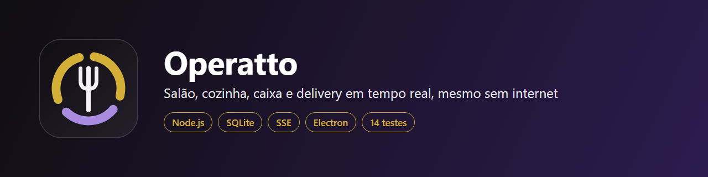

# Operatto



Sistema de gestão para restaurantes: salão, cozinha, caixa e delivery funcionando ao mesmo tempo em vários aparelhos da mesma rede, mesmo sem internet. O computador do caixa roda o servidor, e celulares, tablets e TVs acessam pelo navegador.

Destaques: atualização em tempo real (SSE), login por PIN com perfis e bloqueio após 5 erros, pizza meio a meio, divisão de conta, abertura e fechamento de caixa e cópia de segurança diária.

## Tecnologias

Node.js (node:http e node:sqlite), HTML, CSS, JavaScript, Electron e um aplicativo Android em Java.

## Como rodar

```
npm install
npm start        # abre o programa do caixa
npm run servidor # só o servidor, em http://localhost:8787
npm test         # 14 testes automatizados
npm run check    # confere a sintaxe
```

O cardápio incluído é apenas um exemplo, com preços ilustrativos.

## Autoria

Desenvolvido por Dayane Ferreira, com apoio de IA. Código publicado para avaliação do meu trabalho. Todos os direitos reservados.
